# Flujo lógico del notebook · Fase 1

**Aprobado el 2026-11-04** con los ajustes del equipo: el EDA y la huella de crudeza más detallados, y las decisiones D1–D5.

**Revisión del 2026-11-05:** el flujo empieza por **cómo vienen los datos** (plantas, hojas, sanas frente a afectadas, variables iniciales) y después explica **qué variables se agregan y por qué**.

Entre corchetes va el criterio de la rúbrica v1.4 que cubre cada paso.

```mermaid
flowchart TD
    S0["0 · Configuración<br/>semilla 42 · rutas · decisiones del equipo"] --> S1
    S1["1 · Datos crudos<br/>archivos · SHA-256 vs Mendeley<br/>qué trae cada anotación · se elimina 'Created By'"] --> S2
    S2["2 · ¿Cómo vienen los datos? [C1]<br/>cultivos · plantas · fotos · hojas (inferidas)<br/>sanas vs afectadas · EXIF · huella de crudeza<br/>tabla de variables iniciales"] --> S3
    S3["3 · Variables agregadas<br/>recorte de la hoja → 28 rasgos (color, lesión, índices, textura)<br/>por qué cada familia · cuáles entran al modelo (27)"] --> S4
    S4["4 · EDA de las variables [C1]<br/>NaN · ceros · atípicos IQR (se conservan)<br/>violín/boxplot · Spearman/VIF · confusores"] --> S5
    S5["5 · Clima y grupos<br/>NASA POWER 60 días · 10 filas de acoplamiento<br/>grupos = planta ∪ duplicados"] --> S6
    S6["6 · Partición 70/15/15 agrupada [C1]"] --> S7
    S7["7 · Escalamiento solo con train"] --> S8
    S8["8 · MLP (logit, sin Sigmoid) [C2]"] --> S9
    S9["9 · Entrenamiento base R0 [C2]<br/>bucle explícito · checkpoints"] --> S10
    S10["10 · Sobreajuste R1 → regularización [C3]<br/>R1-ES · R2 · R3a/R3b · R4 · parada temprana"] --> S11
    S11["11 · Evaluación [C4]<br/>umbral en validación → PRUEBA una vez · subgrupos"] --> S12
    S12["12 · Interpretación y ética [C4]"] --> S13
    S13["13 · Auditoría a la IA [C5]<br/>real (paciencia) + inducida (partición)"] --> S14
    S14["14 · Conclusiones → resultados.json → informe [C6]"]
```



## Pasos 2 a 4 en detalle

```
[2 · ¿CÓMO VIENEN LOS DATOS?]
   ├─ 2.1 Nombre del archivo → cultivo, planta, cara (haz/envés), foto
   ├─ 2.2 Conteos: 12 cultivos · 390 plantas · 1.560 fotos (4 por planta)
   │      ¿Cuántas hojas? Por la coincidencia de etiquetas haz 1 = envés 1 (89 %),
   │      se infieren 2 hojas por planta × 2 caras ≈ 780 hojas (no documentado)
   ├─ 2.3 Objetivo: 791 sanas (50,7 %) vs 769 afectadas (49,3 %) · 6 clases originales
   ├─ 2.4 EXIF: 5 fechas · 4 celulares · 3 resoluciones · 0 GPS
   ├─ 2.5 Huella de crudeza: 23,5 % de celdas vacías · 67 grupos de duplicados (se conservan)
   └─ 2.6 Tabla de variables iniciales: origen y uso de cada una

[3 · VARIABLES AGREGADAS]
   ├─ Por qué: el MLP necesita números; la foto se resume en rasgos con significado biológico
   ├─ Cómo: polígono → recorte de la hoja → 256 px → 28 rasgos
   └─ Cuáles entran: 27 (pct_verde = 1 − pct_lesion se excluye; dispositivo y fecha no son predictores)

[4 · EDA DE LAS VARIABLES AGREGADAS]
   ├─ Entrada: data/processed/rocole_tabular_features_fase1.csv
   ├─ 4.1 NaN, ceros anómalos, atípicos IQR (sanas vs roya 3–4)
   ├─ 4.2 Distribuciones por clase binaria y por severidad
   ├─ 4.3 Correlación de Spearman/Pearson y VIF
   ├─ 4.4 Confusores: dispositivo, fecha y cara (V de Cramér)
   ├─ Decisión: no eliminar los atípicos biológicos (roya de grado 4)
   └─ Entregable: figuras eda_*.png + huella de crudeza (resultados.json)
```
